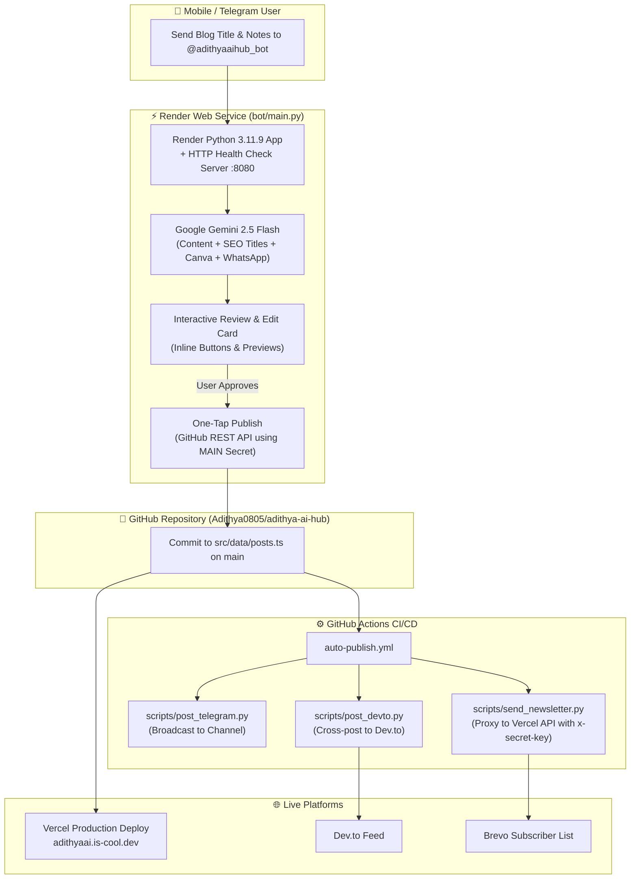

# 🚀 Adithya AI Hub & Autonomous Content Automation Engine

[](https://adithyaai.is-cool.dev)
[](https://t.me/adithyaaihub_bot)
[](https://python.org)
[](https://vitejs.dev/)
[](https://render.com)
[](https://github.com/Adithya0805/adithya-ai-hub/actions)

An end-to-end autonomous developer platform combining a high-performance **React + Vite + TypeScript** portfolio with an intelligent **Telegram AI Publishing Engine** powered by **Google Gemini 2.5 Flash** and automated distribution pipelines via **GitHub Actions**, **Dev.to**, and **Brevo**.

---

## 📑 Table of Contents
1. [Overview & Highlights](#-overview--highlights)
2. [System Architecture](#-system-architecture)
3. [How the Telegram Bot Works (v2)](#-how-the-telegram-bot-works-v2)
4. [Automation Pipelines (CI/CD)](#-automation-pipelines-cicd)
5. [Development Process & Solved Challenges](#-development-process--solved-challenges)
6. [Repository Structure](#-repository-structure)
7. [Environment Variables & Secrets](#-environment-variables--secrets)
8. [Local Development & Setup](#-local-development--setup)
9. [Deployment Guide](#-deployment-guide)

---

## 🌟 Overview & Highlights

- **Dynamic Developer Portfolio**: Built with React 18, Vite, TypeScript, Tailwind CSS, Lucide icons, and Shadcn UI. Features dynamic SEO metadata via `react-helmet-async` and Google-compliant `BlogPosting` JSON-LD schema.
- **AI-Powered Mobile Publishing via Telegram**: Draft, review, edit, and publish SEO-optimized technical blog posts right from your phone in under 60 seconds using `@adithyaaihub_bot`.
- **High-Quality Technical Content**: Powered by Gemini 2.5 Flash with strict guidelines:
  - 350–450 focused words without AI fluff.
  - Realistic developer perspective with actual project references (LangGraph, AWS Bedrock, Pinecone, FastAPI, Supabase).
  - Explicit error-and-learning structure: Hook $\rightarrow$ Real Situation $\rightarrow$ What went wrong first $\rightarrow$ 3 actionable takeaways.
  - Auto-generated 60-character Google SEO title, 155-character meta description, 1200x630 Canva cover image prompt, and formatted WhatsApp status text.
- **GitOps Architecture**: Publishing directly commits to `src/data/posts.ts` via the GitHub REST API without requiring local git commands or a command-line interface.
- **Multi-Channel Auto-Distribution**: On push to `main`:
  - Instant Telegram channel broadcast.
  - Canonical cross-posting to **Dev.to**.
  - Email newsletter broadcast to **Brevo** subscribers via a secure Vercel proxy.
  - Automatic production deployment on Vercel.
- **Automated Health & Telemetry**:
  - Scheduled health checks every 6 hours.
  - Daily GitHub activity digests at 9:00 AM IST.
  - Weekly newsletter digests on Sundays at 3:30 PM IST.
  - Weekly analytics and subscriber growth reports on Sundays at 8:00 PM IST.

---

## 🏛 System Architecture



---

## 🤖 How the Telegram Bot Works (v2)

The bot (`bot/main.py`) acts as an autonomous editorial assistant:

1. **Initiate**: Send any blog topic or raw idea to the bot (e.g., `"Building Agentic Workflows with LangGraph"`).
2. **Category Selection**: Choose from predefined categories (*Machine Learning*, *Interview Prep*, *Career*, *Python*, *Cloud & AI*, *Project*).
3. **Personal Context / Notes**: Send personal debugging moments or technical details to include, or tap `⚡ Skip — Generate Now`.
4. **Generation with Gemini 2.5 Flash**:
   - Generates 350–450 word structured post in clean HTML.
   - Generates Google SEO title tag ($\le$ 60 characters).
   - Generates meta description excerpt ($\le$ 155 characters).
   - Generates a ready-to-use 1200x630 Canva cover image design prompt.
   - Generates punchy WhatsApp status text with direct links.
5. **Review & Edit**:
   - Bot displays word count validation (`✅ Good length` for 300–500 words).
   - Sends full plain-text preview split into chunks to avoid message limits.
   - Inline keyboard controls:
     - `✏️ Edit Title` — updates title, slug, and assets.
     - `✏️ Edit Excerpt` — adjusts meta description.
     - `🔖 Mark Featured` — toggles featured status on the homepage.
     - `🔄 Regenerate` — requests a fresh draft from Gemini.
     - `❌ Discard` — cancels the draft.
     - `✅ Publish Now` — commits directly to GitHub.
6. **Publishing**:
   - Encodes the new post object into `src/data/posts.ts` using base64.
   - Pushes commit directly to `origin/main` with the commit message `blog: <title>`.
   - Sends the formatted WhatsApp status text directly to your chat for immediate copy-pasting.

---

## ⚙️ Automation Pipelines (CI/CD)

All workflows live in `.github/workflows/` and rely on modular Python scripts in `scripts/`:

| Workflow | Trigger | Description | Script(s) Used |
|---|---|---|---|
| **Auto-Publish** (`auto-publish.yml`) | Push to `main` modifying `src/data/posts.ts` | Extracts latest post, broadcasts to Telegram, cross-posts to Dev.to, and delivers Brevo newsletter. | `extract_latest_post.py`, `post_telegram.py`, `post_devto.py`, `send_newsletter.py` |
| **Health Monitor** (`health-monitor.yml`) | Every 6 hours (`0 */6 * * *`) | Pings live portfolio and bot endpoints; alerts Telegram on downtime. | `health_check.py` |
| **Daily Summary** (`daily-summary.yml`) | Daily at 9:00 AM IST (`30 3 * * *`) | Compiles 24-hour GitHub commits, site metrics, and sends morning update to Telegram. | `daily_summary.py` |
| **Weekly Newsletter** (`weekly-newsletter.yml`) | Sundays at 3:30 PM IST (`0 10 * * 0`) | Aggregates the week's posts into an editorial digest and dispatches via Brevo. | `weekly_digest.py` |
| **Weekly Analytics** (`weekly-stats.yml`) | Sundays at 8:00 PM IST (`30 14 * * 0`) | Pulls commit counts, post counts, and active Brevo subscriber totals into Telegram. | `weekly_report.py` |

---

## 🛠 Development Process & Solved Challenges

During the design, deployment, and stabilization of this platform, we encountered and resolved several architectural and platform-specific constraints:

### 1. GitHub Actions Secret Naming Restrictions (`MAIN` vs `GITHUB_PAT`)
- **Problem**: GitHub Actions strictly forbids user-defined repository secrets that start with `GITHUB_` (e.g., `GITHUB_PAT`), producing an error when saving secrets.
- **Solution**: Standardized the personal access token across all scripts, GitHub Actions workflows, Render environment variables, and `bot/main.py` under the name **`MAIN`**, with backwards-compatible fallback (`os.environ.get('MAIN') or os.environ.get('GITHUB_PAT')`).

### 2. Render Web Service Port Binding Requirements
- **Problem**: Deploying the Telegram polling bot as a standard Web Service on Render caused builds to fail or time out after 15 minutes with *"Port scan timeout / No open ports detected"*.
- **Solution**: Embedded a lightweight, concurrent Python `http.server.HTTPServer` running as a background daemon inside `bot/main.py` on `$PORT` (default `8080`). Render detects the open HTTP port and reports healthy uptime while Telegram's long-polling loop runs seamlessly in parallel.

### 3. Python Runtime Pinning (Python 3.11.9)
- **Problem**: Render build environments dynamically defaulted to experimental Python 3.14 alpha images, which broke wheel compilation for native C-extensions like `cryptography` and `pydantic_core`.
- **Solution**: Pinned the exact runtime version to `3.11.9` using `.python-version` at the root and `bot/.python-version`.

### 4. Python 3.11 f-string Syntax Constraints
- **Problem**: Python 3.11 does not permit backslashes inside f-string interpolation expressions (`{...}`), causing syntax errors during post escaping.
- **Solution**: Refactored string character escaping outside of f-strings using explicit variables (`chr(39)` and `chr(92)`) in `build_post_entry()`.

### 5. Telegram 64-Byte Callback Data Limit
- **Problem**: Telegram inline keyboard buttons enforce a strict 64-byte limit on `callback_data`. Passing dynamic blog titles inside button callbacks resulted in `BadRequest: Button_data_invalid` for longer titles.
- **Solution**: Implemented an indexed callback architecture (`cat:0`, `cat:1`, ..., `cat:5`) while maintaining session state in memory and `context.user_data`.

### 6. Gemini API Migration (Gemini 2.5 Flash)
- **Problem**: Legacy `gemini-1.5-flash` endpoints returned `404 Not Found` in newer Google Generative AI SDK environments.
- **Solution**: Upgraded model configuration to `gemini-2.5-flash` with a resilient fallback mechanism to `gemini-flash-latest`.

### 7. Brevo API IP Restrictions & GitHub Actions Runners
- **Problem**: GitHub Actions runners frequently triggered Brevo API `401 Unauthorized / Key not found` errors due to ephemeral IP ranges and API restriction policies.
- **Solution**: Routed newsletter requests through authorized Vercel Serverless Functions (`/api/send-newsletter` and `/api/subscribers`), secured by an `x-secret-key` header (`NEWSLETTER_SECRET`). Scripts automatically prioritize the Vercel proxy before falling back to direct Brevo API calls.

### 8. Bot Content Quality & SEO Modernization (v2 Upgrade)
- **Problem**: Initial AI generations tended to produce generic, repetitive, 1000+ word essays lacking practical developer identity and SEO tag structure.
- **Solution**: Overhauled `generate_post()` to enforce high-impact 350–450 word posts focused on real engineering challenges, added separate `seoTitle` generation ($\le$ 60 chars), 155-character meta descriptions, and updated the frontend `BlogPost.tsx` to dynamically render OpenGraph, Twitter card, and `BlogPosting` JSON-LD schemas.

---

## 📁 Repository Structure

```text
adithya-ai-hub/
├── .github/
│   └── workflows/
│       ├── auto-publish.yml        # Multi-channel publishing on blog commit
│       ├── daily-summary.yml       # Morning summary sent to Telegram
│       ├── health-monitor.yml      # Site & bot uptime checks every 6 hours
│       ├── weekly-newsletter.yml   # Weekly Sunday newsletter digest
│       └── weekly-stats.yml        # Sunday evening analytics report
├── api/                            # Vercel Serverless Functions (Brevo Proxies)
│   ├── notify.ts
│   ├── send-newsletter.ts
│   ├── subscribe.ts
│   └── subscribers.ts
├── bot/                            # Autonomous Telegram Publishing Bot
│   ├── .python-version             # Pinned to 3.11.9
│   ├── main.py                     # Bot engine + Gemini + Render HTTP daemon
│   └── requirements.txt            # Python dependencies
├── public/                         # Static assets, sitemap, icons
├── scripts/                        # Automation scripts for GitHub Actions
│   ├── daily_summary.py
│   ├── extract_latest_post.py
│   ├── health_check.py
│   ├── post_devto.py
│   ├── post_telegram.py
│   ├── send_newsletter.py
│   ├── weekly_digest.py
│   └── weekly_report.py
├── src/
│   ├── components/                 # Reusable UI components
│   ├── data/
│   │   └── posts.ts                # Single Source of Truth for blog posts
│   ├── pages/                      # Page components (Home, Blog, BlogPost, etc.)
│   ├── App.tsx
│   └── main.tsx
├── .env.example                    # Environment template
├── .gitignore
├── .python-version                 # Pinned to 3.11.9
├── package.json
├── tailwind.config.ts
├── tsconfig.json
└── vite.config.ts
```

---

## 🔑 Environment Variables & Secrets

### Required Environment Variables

| Variable Name | Required In | Description |
|---|---|---|
| `MAIN` | Render, GitHub Actions, Local | GitHub Personal Access Token (classic, with `repo` scope). |
| `GITHUB_REPO` | Render, GitHub Actions, Local | Repository identifier (`Adithya0805/adithya-ai-hub`). |
| `TELEGRAM_BOT_TOKEN` | Render, GitHub Actions, Local | Telegram Bot API token from `@BotFather`. |
| `TELEGRAM_CHAT_ID` | Render, GitHub Actions, Local | Your numeric Telegram chat ID from `@userinfobot`. |
| `GEMINI_API_KEY` | Render, Local | Google Gemini API key from Google AI Studio. |
| `DEVTO_API_KEY` | GitHub Actions, Local | Dev.to API key (Settings $\rightarrow$ Extensions $\rightarrow$ DEV API Keys). |
| `BREVO_API_KEY` | Vercel, GitHub Actions, Local | Brevo API key for newsletter distribution. |
| `BREVO_LIST_ID` | Vercel, GitHub Actions, Local | Brevo subscriber list ID (integer). |
| `NEWSLETTER_SECRET` | Vercel, GitHub Actions, Local | Shared secret key for the Vercel Brevo proxy (`x-secret-key`). |
| `SITE_URL` | Render, GitHub Actions, Local | Production site URL (`https://adithyaai.is-cool.dev`). |
| `PORT` | Render, Local | HTTP port for Render health check (`8080`). |

> **Note**: To configure local environments, copy `.env.example` to `.env` and fill in the values. Keep `.env` strictly git-ignored.

---

## 💻 Local Development & Setup

### 1. Clone the Repository
```bash
git clone https://github.com/Adithya0805/adithya-ai-hub.git
cd adithya-ai-hub
```

### 2. Frontend Setup
```bash
# Install dependencies
npm install

# Start local Vite development server
npm run dev
```
Open `http://localhost:5173` in your browser.

### 3. Telegram Bot Setup
```bash
# Create and activate Python virtual environment
python -m venv venv
# Windows:
.\venv\Scripts\activate
# Linux/macOS:
source venv/bin/activate

# Install dependencies
pip install -r bot/requirements.txt

# Run bot locally
python bot/main.py
```
Send `/start` to your Telegram bot to test interactive generation.

---

## 🚢 Deployment Guide

### Frontend on Vercel
1. Import repository into [Vercel](https://vercel.com).
2. Framework preset: **Vite**.
3. Build command: `npm run build`.
4. Output directory: `dist`.
5. Configure Environment Variables in Vercel:
   - `BREVO_API_KEY`
   - `BREVO_LIST_ID`
   - `NEWSLETTER_SECRET`

### Telegram Bot on Render
1. Create a new **Web Service** on [Render](https://render.com).
2. Connect your GitHub repository: `Adithya0805/adithya-ai-hub`.
3. Set the following parameters:
   - **Environment**: `Python 3`
   - **Build Command**: `pip install -r bot/requirements.txt`
   - **Start Command**: `python bot/main.py`
4. In the service's **Environment** tab, set:
   - `MAIN`: Your GitHub PAT.
   - `GITHUB_REPO`: `Adithya0805/adithya-ai-hub`
   - `TELEGRAM_BOT_TOKEN`: Your Telegram bot token.
   - `TELEGRAM_CHAT_ID`: Your Telegram numeric chat ID.
   - `GEMINI_API_KEY`: Your Gemini API key.
   - `SITE_URL`: `https://adithyaai.is-cool.dev`
   - `PORT`: `8080`

### GitHub Repository Secrets
Under your GitHub repository **Settings $\rightarrow$ Secrets and variables $\rightarrow$ Actions**, add the following repository secrets:
- `MAIN`
- `TELEGRAM_BOT_TOKEN`
- `TELEGRAM_CHAT_ID`
- `DEVTO_API_KEY`
- `BREVO_API_KEY`
- `BREVO_LIST_ID`
- `NEWSLETTER_SECRET`
- `SITE_URL`

---

## 📜 License & Credits

- Created and maintained by **Adithya Kuppusamy**.
- Powered by [Google Gemini](https://ai.google.dev/), [React](https://react.dev/), [Vite](https://vitejs.dev/), [Render](https://render.com), and [Vercel](https://vercel.com).
